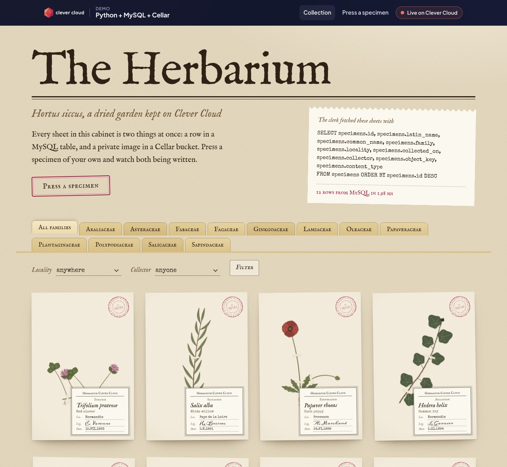
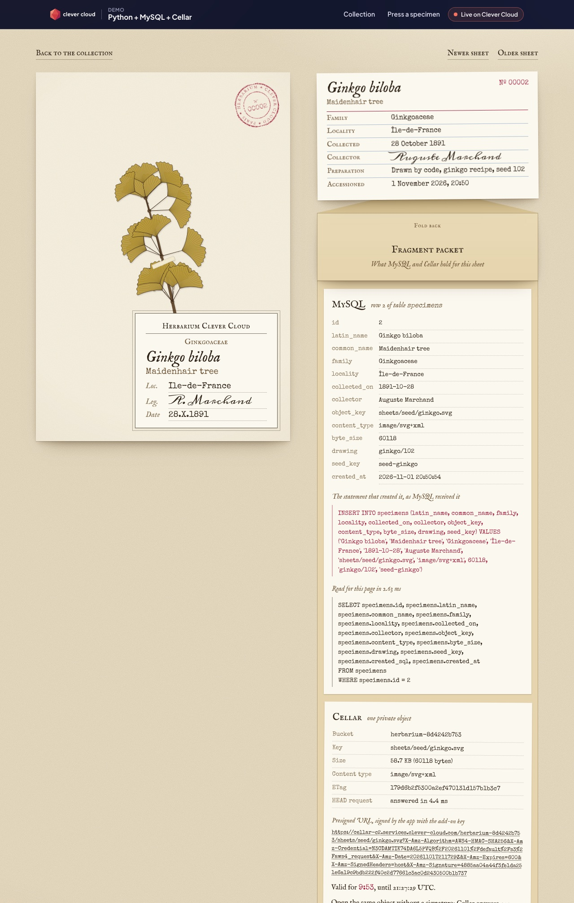

# The Herbarium: Python, MySQL and Cellar on Clever Cloud

> A digital herbarium where visitors press specimens into a living collection. Every sheet is two things at once: its label is a **row in a MySQL table**, its pressed image is a **private object in a Cellar bucket**, served through short-lived presigned URLs. Twelve botanical plates are drawn by code at first start. A fragment packet glued on each sheet unfolds to show what the services hold: the MySQL row, the exact `INSERT` that created it, the Cellar key, size, ETag and the presigned URL expiry.



**Run it yourself.** The hosted demo was taken down after the presales review (November 2026). The steps in [Deploy on Clever Cloud](#deploy-on-clever-cloud) recreate it from scratch in about 10 minutes, most of it waiting for the MySQL add-on.

**Get certified.** This demo runs on Clever Cloud. To deploy your own apps the same way, get certified at the [Clever Cloud Academy](https://academy.clever.cloud/).

---

## Deploy on Clever Cloud

You need [clever-tools](https://www.clever.cloud/developers/doc/cli/) (`clever login` done) and the ID of the organisation that will own the resources (`orga_…`, shown in the Console).

```bash
# 1. The app (run from the repo root: it links the folder to the new app)
clever create --type python demo-python-mysql-cellar --org <org_id> --region par
clever scale --min-flavor nano --max-flavor XS --min-instances 1 --max-instances 2
clever scale --build-flavor M

# 2. The add-ons, then link them to the app
clever addon create mysql-addon herbarium-mysql --plan xxs_sml --region par --org <org_id> --option encryption=true
clever addon create cellar-addon herbarium-cellar --plan S --region par --org <org_id>
clever service link-addon herbarium-mysql
clever service link-addon herbarium-cellar

# 3. Run command and health check
clever env set CC_PYTHON_UV_RUN_COMMAND "uv run --no-sync python -m herbarium"
clever env set CC_HEALTH_CHECK_PATH /health

# 4. Deploy
clever deploy
clever open
```

That is all. There is no secret to generate: the linked add-ons inject `MYSQL_ADDON_URI`, `CELLAR_ADDON_HOST`, `CELLAR_ADDON_KEY_ID` and `CELLAR_ADDON_KEY_SECRET`, which the code reads as they are. Cellar offers no encryption option (its only plan is `S`).

Clever Cloud sees `uv.lock`, runs `uv sync --locked --no-dev` at build, then starts the app with the run command ([native uv deployment](https://www.clever.cloud/developers/doc/deploy/applications/python/uv/)). Python 3.14 comes from `requires-python` in `pyproject.toml`. At first start the app creates its table, creates its private bucket and presses the twelve seed specimens. Both steps are idempotent, so there is no setup script. Check it with `GET /health/deep`, which reaches MySQL and Cellar.

The demo runs on a `nano` instance (scaling `nano` to `XS`, 1 to 2 instances) with a dedicated `M` build instance.

---

## What each add-on does here



| Add-on | Role in the herbarium | Variables read by the code |
|---|---|---|
| **MySQL** (`xxs_sml`, encrypted at rest) | The register: one row per specimen in table `specimens` (Latin name, family, locality, collector, Cellar key, size…). The exact `INSERT` that created each row is kept, as MySQL received it, and shown on the sheet. | `MYSQL_ADDON_URI` |
| **Cellar** (S3-compatible) | The pressed images, in one **private** bucket. The browser only gets presigned URLs valid for 10 minutes, signed by the app. Opening the same object without a signature returns 403. | `CELLAR_ADDON_HOST`, `CELLAR_ADDON_KEY_ID`, `CELLAR_ADDON_KEY_SECRET` |

Optional: `CELLAR_BUCKET` forces the bucket name. By default it is `herbarium-` plus a hash of the Cellar key id, so it is unique per add-on and needs no setup.

Platform variables shown in the "Running on Clever Cloud" panel: `CC_APP_NAME`, `APP_ID`, `INSTANCE_NUMBER`, `INSTANCE_TYPE`, `CC_PRETTY_INSTANCE_NAME`, `CC_COMMIT_ID`, `CC_DEPLOYMENT_ID`.

---

## Routes

| Route | What it does |
|---|---|
| `GET /` | The cabinet: a grid of sheets, filters by family, locality and collector, and the `SELECT` that fetched them |
| `GET /specimen/{id}` | One sheet, its accession record and the fragment packet (MySQL row and SQL, Cellar object and presigned URL); add `#packet` to open the packet |
| `GET /press`, `POST /press` | Press a specimen: a plant drawn by code, or your own photo (JPEG, PNG, WebP or GIF, 5 MB max, checked by content) |
| `GET /draw/{kind}.svg?seed=N` | A botanical plate drawn by code (12 recipes, endless seeds) |
| `GET /api/specimens/{id}` | The same record as JSON |
| `GET /health` | 200, never touches an add-on |
| `GET /health/deep` | Checks MySQL (`SELECT VERSION()`) and Cellar (`HEAD` on the bucket) |

Pressing writes the image to Cellar first, then the row to MySQL. If the insert fails, the object is deleted: no image without a label. The cabinet holds 400 sheets, and one visitor can press 12 specimens per 10 minutes.

---

## Run it locally

```bash
brew install mysql@8.4 && brew services start mysql@8.4
mysql -uroot -e "CREATE DATABASE herbarium; CREATE DATABASE herbarium_test"
uvx --from "moto[server]" moto_server -p 9100 &      # a local S3 standing in for Cellar
set -a; . ./.env.example; set +a
uv run python -m herbarium                          # http://localhost:8080
```

Tests (one command; the MySQL ones use `TEST_MYSQL_URI`, default `mysql://root@127.0.0.1:3306/herbarium_test`, and S3 is mocked in-process):

```bash
uv run pytest
```

---

## Project structure

```
herbarium/
  main.py        FastAPI routes, form validation, page rendering, security headers
  db.py          MySQL: the specimens table, and the exact SQL captured from PyMySQL
  cellar.py      Cellar: boto3 client, private bucket, upload, presigned URLs, bucket stats
  drawing.py     The botanical plates: stems, leaves, flowers and roots drawn as SVG
  seed.py        The twelve seed specimens, idempotent
  config.py      Add-on and platform variables
  __main__.py    uvicorn on 0.0.0.0:$PORT (the Clever Cloud run command)
  templates/     Jinja2 pages; brand/ holds the Clever Brand Kit pieces
  static/        herbarium.css (the cabinet), herbarium.js (a little vanilla JS), cc-brand.css
tests/           pytest: drawings, validation, health, press then read back through MySQL and S3
```

Stack: Python 3.14, FastAPI, Jinja2, SQLAlchemy 2 with PyMySQL, boto3, uvicorn, uv. Fonts: IM Fell English, Special Elite and Meddon from Google Fonts. Every illustration is drawn by code; the collectors are fictional.

## License

MIT, see [LICENSE](LICENSE). Made by [Vitiosum](https://github.com/Vitiosum).
